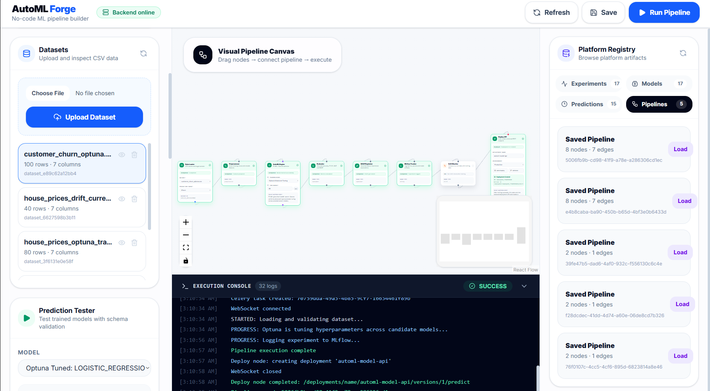
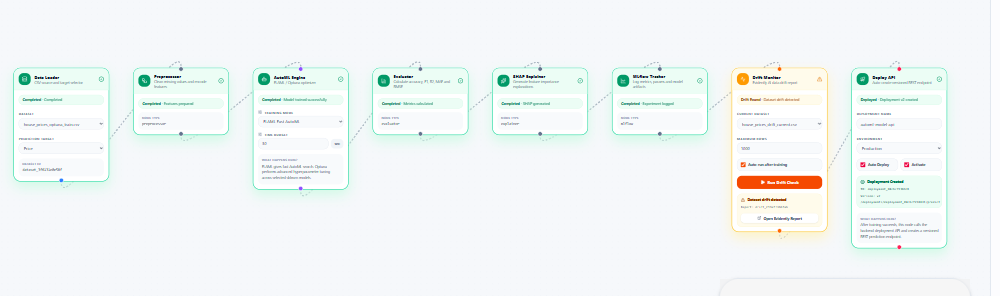

# 🚀 ModelPilot

### Production-Oriented AutoML & Machine Learning Lifecycle Platform

ModelPilot is an end-to-end machine learning platform that simplifies the complete ML lifecycle — from **dataset ingestion and visual pipeline construction to automated model training, experiment tracking, explainability, drift monitoring, and isolated model deployment**.

Built with a production-first architecture, ModelPilot combines **AutoML, asynchronous job processing, experiment management, model explainability, artifact storage, and containerized model serving** into a unified platform.

> **Build → Train → Evaluate → Explain → Monitor → Deploy**

---

## ✨ Key Features

* 🧩 **Visual ML Pipeline Builder** using ReactFlow
* 🤖 **Automated Model Training** using FLAML AutoML
* 🎯 **Hyperparameter Optimization** using Optuna
* 📊 **Experiment Tracking** with MLflow
* 🔍 **Model Explainability** using SHAP
* 📈 **Data & Model Drift Monitoring**
* 🗂️ **Artifact Storage** using MinIO / S3
* ⚡ **Asynchronous ML Workloads** using Celery + Redis
* 🐳 **Isolated Model Deployment** using Docker
* 🔐 **JWT Authentication & Project Isolation**
* 🔄 **Real-Time Updates** using WebSockets
* 🧪 **Custom Model Zoo**
* 📋 **Prediction Logging & Monitoring**

---

# 🖥️ Project Preview

> ModelPilot is currently under active development and is not publicly deployed yet.
> The following screenshots showcase the current working application.

## 📊 Dashboard



---

## 🧩 Visual ML Pipeline Builder

Build and execute machine learning workflows through an interactive visual pipeline interface.



### Example Workflow

```text
Dataset
   ↓
Data Preprocessing
   ↓
Feature Engineering
   ↓
AutoML Training
   ↓
Model Evaluation
   ↓
Model Registry
   ↓
Deployment
```

---

## 📈 Experiment & Model Results

Track training runs, compare models, analyze performance metrics, and identify the best-performing model.


---

## 🔍 Model Explainability

Understand model behavior through feature-level explanations powered by SHAP.


---

## 📡 Drift Monitoring

Monitor changes in incoming data and identify potential distribution shifts that can affect model reliability.


---

## 🚀 Model Deployment

Deploy trained models through independent Docker-based model runtimes.


---

# 🏗️ System Architecture

```text
                    ┌───────────────────────┐
                    │      React Frontend   │
                    │   ReactFlow + Vite    │
                    └───────────┬───────────┘
                                │
                                ▼
                    ┌───────────────────────┐
                    │      FastAPI API      │
                    │ Authentication / API  │
                    └───────────┬───────────┘
                                │
              ┌─────────────────┼─────────────────┐
              │                 │                 │
              ▼                 ▼                 ▼
        ┌───────────┐     ┌───────────┐    ┌────────────┐
        │ PostgreSQL│     │   Redis   │    │   MinIO    │
        │ Metadata  │     │ Broker /  │    │ Artifacts  │
        │           │     │ Backend   │    │            │
        └───────────┘     └─────┬─────┘    └────────────┘
                                │
                                ▼
                         ┌─────────────┐
                         │   Celery    │
                         │   Workers   │
                         └──────┬──────┘
                                │
                    ┌───────────┼────────────┐
                    │           │            │
                    ▼           ▼            ▼
                ┌───────┐  ┌────────┐  ┌─────────┐
                │ FLAML │  │ Optuna │  │  SHAP   │
                │ AutoML│  │ Tuning │  │ Explain │
                └───────┘  └────────┘  └─────────┘
                                │
                                ▼
                         ┌─────────────┐
                         │   MLflow    │
                         │ Experiments │
                         │ & Registry  │
                         └──────┬──────┘
                                │
                                ▼
                       ┌──────────────────┐
                       │ Docker Model     │
                       │ Runtime          │
                       │                  │
                       │ /health          │
                       │ /metadata        │
                       │ /predict         │
                       └──────────────────┘
```

---

# 🛠️ Tech Stack

## Frontend

* React
* Vite
* ReactFlow
* Axios

## Backend

* FastAPI
* Uvicorn
* SQLAlchemy
* PostgreSQL
* Pydantic

## Machine Learning

* Python
* scikit-learn
* FLAML
* Optuna
* SHAP
* pandas
* NumPy
* SciPy
* joblib

## MLOps & Infrastructure

* MLflow
* MinIO / S3
* Celery
* Redis
* Docker
* WebSockets

## Monitoring

* Evidently

---

# 🔄 Machine Learning Lifecycle

### 1. Dataset Ingestion

Upload and manage datasets that serve as the foundation of the ML workflow.

### 2. Pipeline Construction

Create machine learning workflows using the visual pipeline builder.

### 3. Automated Training

FLAML automatically searches for suitable models and configurations within a specified training budget.

### 4. Hyperparameter Optimization

Optuna performs systematic hyperparameter optimization to improve model performance.

### 5. Experiment Tracking

MLflow tracks experiments, model metrics, parameters, and artifacts.

### 6. Model Explainability

SHAP provides feature-level explanations to understand model predictions.

### 7. Drift Monitoring

Evidently monitors incoming data and detects potential distribution shifts.

### 8. Model Deployment

Trained models can be packaged into independent Docker runtimes and exposed through prediction APIs.

---

# 🧠 Custom Model Zoo

ModelPilot includes a custom **Model Zoo** for managing reusable model implementations and trained model artifacts.

The architecture is designed so that models can be independently identified, managed, and deployed instead of coupling all inference workloads to a single application process.

---

# ⚡ Asynchronous ML Architecture

Machine learning training can be computationally expensive and should not block API requests.

ModelPilot separates request handling from long-running ML workloads using **Celery and Redis**.

```text
Client
  │
  ▼
FastAPI
  │
  ▼
Celery Task
  │
  ▼
Redis
  │
  ▼
Celery Worker
  │
  ├── Data Processing
  ├── AutoML
  ├── Hyperparameter Tuning
  ├── Model Training
  └── Artifact Generation
```

This architecture keeps the API responsive while computationally intensive workloads execute asynchronously.

---

# 🔐 Authentication & Project Isolation

ModelPilot provides secure project-level resource management.

### Authentication

* JWT-based authentication
* Protected API routes
* Token-based authorization

### Project Isolation

ML resources are associated with individual projects, helping prevent cross-project access to:

* Datasets
* Experiments
* Trained Models
* Predictions
* Drift Reports
* Pipeline Graphs
* Deployment Information

---

# 🐳 Independent Model Runtime

One of the core architectural features of ModelPilot is its independent Docker-based model serving layer.

Each trained model can run inside its own isolated runtime.

### Model Runtime API

```http
GET /health
```

Returns the health status of the model service.

```http
GET /metadata
```

Returns model metadata and the expected feature schema.

```http
POST /predict
```

Accepts inference data and returns predictions.

### Example Request

```json
{
  "features": {
    "feature_1": 10.5,
    "feature_2": 20.3,
    "feature_3": 5.7
  }
}
```

### Example Response

```json
{
  "prediction": 360030.544
}
```

This separation creates a clean boundary between the **ML management platform** and the **model inference runtime**.

---

# 📦 Project Structure

```text
ModelPilot/
│
├── backend/
│   ├── app/
│   │   ├── core/
│   │   ├── db/
│   │   ├── dependencies/
│   │   ├── ml/
│   │   ├── models/
│   │   ├── routes/
│   │   └── schemas/
│   │
│   ├── Dockerfile
│   └── requirements.txt
│
├── frontend/
│   ├── src/
│   │   ├── components/
│   │   ├── nodes/
│   │   ├── pages/
│   │   └── services/
│   │
│   └── package.json
│
├── model-runtime/
│   ├── app/
│   ├── Dockerfile
│   └── requirements.txt
│
└── README.md
```

---

# 🚀 Getting Started

> ModelPilot is currently designed for local development and is not publicly deployed yet.

## Prerequisites

Make sure the following are installed:

* Python 3.10+
* Node.js
* PostgreSQL
* Redis
* Docker
* MinIO
* Git

---

## Clone the Repository

```bash
git clone <repository-url>
cd ModelPilot
```

---

## Backend Setup

```bash
cd backend

python -m venv .venv
```

### Windows

```bash
.venv\Scripts\activate
```

### Linux / macOS

```bash
source .venv/bin/activate
```

Install dependencies:

```bash
pip install -r requirements.txt
```

Start the FastAPI server:

```bash
uvicorn app.main:app --reload
```

---

## Start Celery Worker

```bash
celery -A app.celery_app.celery worker --loglevel=info
```

---

## Frontend Setup

```bash
cd frontend

npm install
npm run dev
```

---

# 📊 Current Development Status

| Feature                            | Status         |
| ---------------------------------- | -------------- |
| Authentication                     | ✅ Complete     |
| Project Isolation                  | ✅ Complete     |
| Dataset Management                 | ✅ Complete     |
| Visual Pipeline Builder            | ✅ Complete     |
| FLAML AutoML                       | ✅ Complete     |
| Optuna Optimization                | ✅ Complete     |
| MLflow Integration                 | ✅ Complete     |
| MinIO Artifact Storage             | ✅ Complete     |
| SHAP Explainability                | ✅ Complete     |
| Drift Monitoring                   | ✅ Complete     |
| WebSocket Updates                  | ✅ Complete     |
| Custom Model Zoo                   | ✅ Complete     |
| Independent Docker Model Runtime   | ✅ Validated    |
| Automatic Deployment Orchestration | 🔄 In Progress |
| Public Cloud Deployment            | 🔜 Planned     |

---

# 🗺️ Roadmap

## Near Term

* [ ] Complete automated model deployment orchestration
* [ ] Improve experiment and dataset versioning
* [ ] Enhance model monitoring
* [ ] Expand model registry capabilities
* [ ] Improve deployment management UI

## Future

* [ ] LIME-based explainability
* [ ] Advanced automated EDA
* [ ] Multimodal ML support
* [ ] PyTorch / GPU workers
* [ ] Kubernetes-based model orchestration
* [ ] Terraform infrastructure automation
* [ ] Advanced collaboration and team access
* [ ] Cloud deployment

---

# 🎯 Engineering Highlights

ModelPilot focuses on solving practical engineering challenges involved in building a production-oriented ML platform:

* **Decoupled API and ML workloads** through Celery
* **Persistent metadata management** through PostgreSQL
* **Object-based artifact storage** through MinIO
* **Experiment tracking and reproducibility** through MLflow
* **Automated model selection** through FLAML
* **Hyperparameter optimization** through Optuna
* **Explainable predictions** through SHAP
* **Data drift monitoring** through Evidently
* **Isolated inference environments** through Docker
* **Project-level resource isolation**
* **Real-time application updates** through WebSockets

---

# 🔬 Engineering Focus

ModelPilot is designed around several principles:

```text
Scalability
    +
Modularity
    +
Reproducibility
    +
Observability
    +
Isolation
    +
Automation
```

The goal is to move beyond a traditional ML notebook workflow and provide an architecture closer to a real-world **ML platform / MLOps system**.

---

# 👩‍💻 Author

**Archita Sarkar**

ModelPilot is a production-oriented machine learning engineering project combining:

**AutoML • MLOps • Distributed Processing • Explainable AI • Monitoring • Containerized Deployment**

---

## ⭐ Support

If you find ModelPilot interesting, consider giving the repository a ⭐ and exploring the architecture, ML pipeline, and deployment workflow.
